# Oyéolouwa Assogba
### Élève-ingénieure en IA & Big Data (BAC+3) — ESIGELEC[cite: 2]

  
  
  

---

### À propos

« Élève-ingénieure à l'ESIGELEC, je conçois ce portfolio comme le reflet direct de mon parcours et de ma passion pour l'intelligence artificielle. Actuellement à la recherche d'une alternance de 36 mois dès novembre 2026[cite: 2], je mets ma rigueur et ma curiosité au service de projets techniques ambitieux, allant de la vision par ordinateur au machine learning appliqué. »

---

### Stack Technique

| Domaine | Technologies |
| :--- | :--- |
| **Langages** | `Python` `SQL` `C` `Java` `JavaScript` `R`[cite: 2] |
| **Data Science & ML** | `Pandas` `NumPy` `Scikit-learn` `PyTorch` `TensorFlow`[cite: 2] |
| **IA Générative & Vision** | `LLM` `RAG` `LangChain` `OpenAI` `OpenCV` `YOLOv8`[cite: 2] |
| **Data Engineering & Cloud** | `ETL` `Data Pipelines` `AWS` `Google Cloud` `Git` `Docker`[cite: 2] |
| **Visualisation & BI** | `Power BI` `Tableau` `Jupyter` `LaTeX`[cite: 2] |

---

### Expériences Professionnelles

* **Stagiaire IA & Robotique — Bénin Excellence** *(juil. — août 2026)*[cite: 2]
  Développement de solutions d'IA et de systèmes robotisés pour l'automatisation du tri. Implémentation de modèles de machine learning et de computer vision pour l'analyse de flux visuels et la détection d'anomalies[cite: 2].
* **Stagiaire Sécurité Électronique — SAGAM Sécurité** *(juil. — août 2025)*[cite: 2]
  Installation, configuration et maintenance de systèmes de sécurité et d'automatismes. Analyse technique des réseaux et exécution de protocoles de maintenance prédictive[cite: 2].

---

### Projets Majeurs

* **Grading Visuel par IA**[cite: 2] — Automatisation du contrôle esthétique de smartphones reconditionnés par détection de micro-rayures (YOLOv8) et classification instantanée par grades (Score : 92 %)[cite: 2].
* **Cotes & Prédiction de Prix**[cite: 2] — Modélisation de régression sous Scikit-Learn pour l'évaluation prédictive de la valeur de revente de terminaux mobiles (Score : 80 %)[cite: 2].
* **Bras Robotique (EEIA)**[cite: 2] — Tri automatisé et intelligent de composants électroniques en laboratoire via la vision et un microcontrôleur ESP32 (Score : 95 %)[cite: 2].

---

### Statistiques & Activité

  
  

